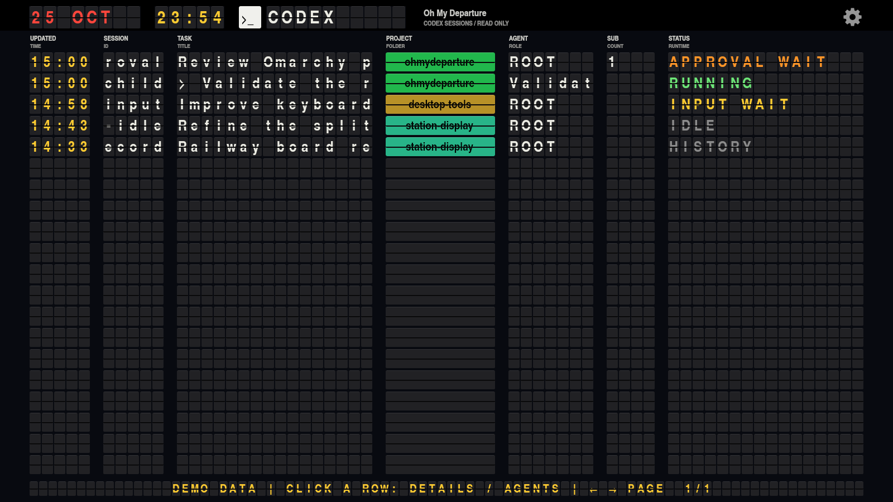

# Oh My Departure

Codex 세션과 에이전트 기록을 공항의 플랩 출발표처럼 보여주는 Linux / Omarchy 앱입니다.
프로젝트의 기본 문서와 UI 언어는 **영문**입니다. 사용자 세션의 제목과 내용은 원문 그대로
표시합니다. 전체 설명은 [English README](README.md)를 참고하세요.



## 실행

```sh
omarchy pkg add base-devel pkgconf qt6-base qt6-wayland python noto-fonts-cjk
make -j"$(nproc)"
./ohmydeparture --windowed
./ohmydeparture --airport ICN --windowed
```

기본 보기는 Codex입니다. 공항·철도는 `--airport` 또는 톱니바퀴 메뉴로 선택합니다.
`make package-omarchy`로 번들을 만든 뒤, 번들 안의 `install.py`를 sudo 없이 실행하면
상단 바 플러그인·앱 메뉴·아이콘을 설치합니다. 자세한 내용은
[번들 설명](packaging/omarchy/README.ko.md)을 참고하세요.

기존 관리형 `rainygirl.rdepartures` 설치는 새 ID `edwardkim.ohmydeparture`로 이전하며,
바 위치와 인라인 설정을 유지합니다. 기존 앱 창을 한 번 닫고 새 앱을 여세요.
기존 마지막 공항·플립 설정은 첫 실행 때 복사하며 원본은 유지합니다.

## 사용

세션·하위 에이전트 행을 **더블클릭**하면 같은 창에서 스플릿 플랩 히스토리 화면으로
전환합니다. 시간·이벤트·기록 내용·결과를 표시하며, 최근 항목 20개를 최대 세 줄씩
미리 봅니다. **← BACK** 플랩 또는 키보드 **←**로 기존 코덱스 보드에 돌아오며,
**→ / Space**로 다음 히스토리 페이지를 봅니다. 상세 화면의 Esc도 보드로 돌아옵니다.
검색·보관 기록·이전 턴·항목 전문은 **Session browser & search…**에서 확인합니다.
톱니바퀴의 **Display settings…**에서 반복 간격(기본 3초, 0은 끄기)과 뒤집기 시간
(기본 0.65초, 0.20–2.00초)을 변경합니다. 프로젝트는 고정 색상 플랩으로 표시하며
부모·하위 에이전트의 색이 일치합니다. 플립 설정은 보드와 히스토리 화면에 함께
적용됩니다. F11은 전체 화면, 세션 보드의 Esc는 창 닫기입니다.

HISTORY는 현재 실행 상태를 모르는 저장 기록, IDLE은 현재 활동이 없음을 뜻합니다.
턴 완료는 프로젝트 완료를 뜻하지 않습니다. 기존 Codex 데몬을 5초마다 조회하며,
없으면 로컬 JSONL 기록을 읽습니다. 에이전트 실행·재개·중단·승인, 명령 실행,
Codex 설정·DB·hook 변경은 하지 않습니다. 스크린샷은 개인정보를 확인한 뒤 공유하세요.
이 문서의 Codex 화면은 가상 데이터입니다. ICN은 내려받은 당일 실제 출발 정보를,
다른 공항·철도 화면은 생성 시간표를 사용합니다.

## 인천공항 실데이터 API 이용 조건

**인천공항 운항정보를 직접 내려받거나 갱신하려면 사용자마다 공공데이터포털
회원가입, 해당 API 활용신청·승인, 본인 인증키 발급을 완료해야 합니다.
번들에 포함된 조회 결과를 보는 데에는 인증키가 필요하지 않습니다.**

1. [공공데이터포털](https://www.data.go.kr/)에 회원가입합니다.
2. [인천국제공항공사_항공기 운항 현황 상세 조회](https://www.data.go.kr/data/15140153/openapi.do)
   서비스 페이지를 엽니다.
3. **활용신청**을 완료하고 승인 상태를 확인합니다. 회원가입만으로 API 사용 권한이
   생기는 것은 아니며, 이 서비스에 대한 활용 승인이 필요합니다.
4. 마이페이지의 API 활용신청·인증키 화면에서 본인 서비스 인증키를 확인합니다.
5. 프로젝트 루트의 `.env`를 생성하거나 기존 파일을 수정합니다.
   [.env.example](.env.example)의 예시를 참고하세요.

```dotenv
ICN_EP=https://apis.data.go.kr/B551177/statusOfAllFltDeOdp
ICN_KEY=YOUR_OWN_DATA_GO_KR_SERVICE_KEY
```

프로젝트는 공용 인증키를 제공하지 않습니다. 본인 키는 로컬 `.env`에 보관하세요.
`.env`와 `.env.*`는 Git에서 제외하며, `.env.example`에는 예시 값만 둡니다.
계정별 호출량과 운영계정 승인 조건은 공공데이터포털에서 확인하세요.

소스 작업본에서 `python3 tools/check-icn-api.py --time-basis S`를 실행하면 출발·도착을
JSON·XML로 검사합니다. 인증키를 숨긴 검사 결과는 `test-output/`에 저장되며,
각 `checks[].items` 배열에 실제 항공편 데이터도 포함합니다. XML 항목도 JSON 객체로 기록합니다.

오늘(한국시간) 출발 데이터를 ICN 전광판에 반영하려면 다음을 실행합니다.

```sh
python3 tools/fetch-icn-departures.py
make -j2
./ohmydeparture --airport ICN --windowed
```

전체 페이지를 받아 `data/icn-departures.json`을 교체하고 실행 파일에 내장합니다.
다운로드 실패 시 기존 파일을 보존합니다. ICN은 실제 운항편인 `Master` 여객편을
표시하며 공동운항 `Slave`는 원본 데이터에 보존하되 화면에서 중복 표시하지 않습니다.
예정·변경 시각, 목적지, 항공사, 편명, 게이트, 운항 상태를 실제 응답에서 가져옵니다.
기본은 영문이며 한국어 화면도 순환합니다. 조회 시각을 KST로 표시하며 자동 갱신은
하지 않습니다. 날짜가 지나면 `REFRESH REQUIRED`와 빈 행을 표시합니다.
다운로드한 해당일 데이터에서 **시스템 현재 시각의 30분 전부터 이후 운항편**을
표시합니다. 변경 시각이 있으면 변경 시각, 없으면 예정 시각을 기준으로 하며,
지연편도 같은 시간 조건을 적용합니다. 화면의 표시 범위는 시스템 시각에 맞춰
움직이며, 이 과정에서 API를 다시 호출하지 않습니다.
데이터가 없거나 잘못되어도 샘플 운항편으로 대체하지 않습니다.
빌드 후에는 실행 중인 앱을 다시 시작해야 합니다. 설치된 번들은
`make package-omarchy`로 다시 만들고 새 설치 프로그램으로 업데이트하세요.

## 정적 공항 코드 데이터

[data/airport-codes.json](data/airport-codes.json)에 **2026-10-26 기준 공항·도시
코드 1,391개**를 저장했습니다. 출처는
[한국공항공사_공항 코드 정보_GW](https://www.data.go.kr/data/15158948/openapi.do)이며,
실행 파일의 `:/data/airport-codes.json` 리소스로 배포합니다.
**이 목록을 사용하는 데 네트워크 연결이나 공항 코드 API 인증키는 필요 없습니다.**
빌드·실행 시 자동으로 내려받지 않으며, 필요할 때 수동으로 갱신합니다.

인천공항 운항 데이터의 `airportCode`와 목록의 `cityCode`를 연결하면 영문 기본
화면에는 `cityEnglish`, 한국어 화면에는 `cityKorean`을 사용할 수 있습니다.
2026-10-26 출발·도착 2,244건에 등장한 공항 코드 137개가 모두 일치했습니다.
`cityJapan`, `cityChina`에도 영어가 들어올 수 있습니다. ICN 실데이터 전광판에서
이 정적 목록으로 목적지 이름을 연결하며, 다른 공항·철도 화면은 생성 시간표를 유지합니다.

추가로 [data/airport-details.json](data/airport-details.json)에 제공된
**대한민국 국토교통부**가 제공한 `IATA_20251231.csv`의 **공항 5,498건**을
영문·한글 공항명, IATA·ICAO 코드와 함께
저장하고 실행 파일에도 내장했습니다. CP949 원본은 `data/sources/`에 보존합니다.
유효한 IATA 코드는 5,305개이며 이 중 19개에 복수 공항 기록이 있습니다.
미입력·형식 오류 코드는 `null`로 처리하고 중복 후보를 모두 보존했습니다.
도시명 표기와 공항 상세 정보를 구분하여 두 정적 목록을 함께 유지합니다.

형식·출처·이용 조건·수동 갱신 절차는 [data/README.md](data/README.md)에 정리했습니다.
목록을 갱신하는 관리자만 해당 API 활용신청·승인과 인증키가 필요하며,
선택 설정인 `ACODE_EP`·`ACODE_KEY`는 [.env.example](.env.example)을 참고합니다.
인천공항 실시간 운항 API의 이용 조건은 위 설명을 따릅니다.

원작은 [rainygirl/R Departures](https://github.com/rainygirl/renkuos-rdeparture)입니다.
MIT 라이선스와 원작 크레딧을 유지하며, 폰트는 GUST Font License를 따릅니다.
[출처와 변경 범위](UPSTREAM.md), [기여 안내](CONTRIBUTING.md)를 확인하세요.
