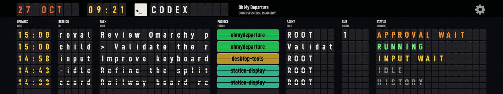
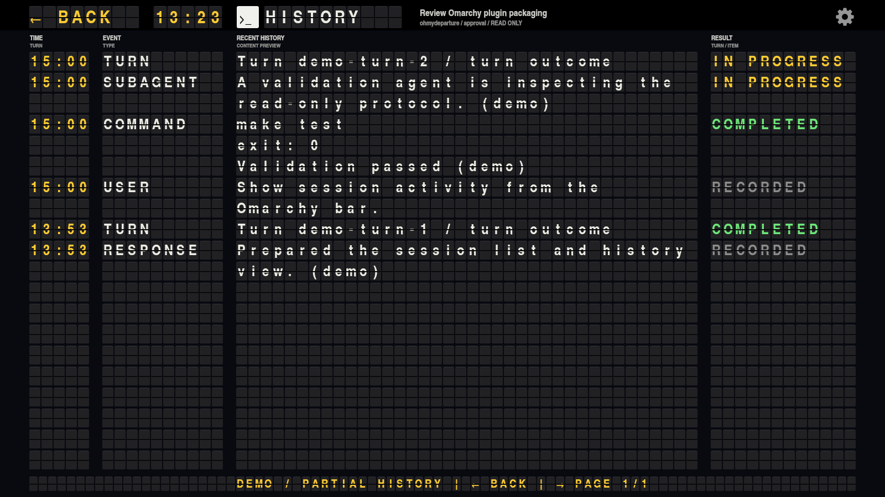
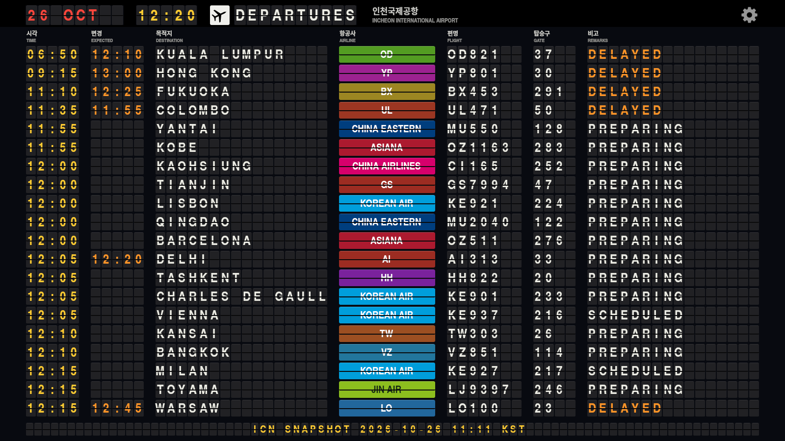

# Oh My Departure

**Your Codex sessions, on a split-flap departure board.**

An English-first Linux desktop application and Omarchy bar plugin. See projects,
child agents and session activity at a glance, then click a row to inspect turns
and tool history. Built on the renderer from
[rainygirl's R Departures](https://github.com/rainygirl/renkuos-rdeparture).

[한국어](README.ko.md) · [Install bundle](packaging/omarchy/README.md) ·
[Changelog](CHANGELOG.md) · [Contributing](CONTRIBUTING.md)


*All sessions in this preview are synthetic. The interface defaults to English;
your session titles and contents are displayed as recorded.*

- Original split-flap rendering with a slower, visible fold, hinge pause and shadows.
- Stable project colours, with matching plaques for parent sessions and child agents.
- Periodic replay every **3 seconds**, adjustable independently of the **0.65-second** flip duration.
- Screen-centred details and settings, search, filters, agent trees and turn/tool history.
- Read-only Codex monitoring, with local history fallback when no daemon is available.
- Eight airport boards and four railway systems inherited from R Departures.



## Build and run

The primary target is **Omarchy / Linux, Qt 6, C++17 and Python 3**. This version
was tested on Omarchy with Qt 6.11 and Hyprland 0.56.2. The native plugin requires
Omarchy's `bar-widget` API; the standalone application also runs without Omarchy.

On Omarchy, install the build and runtime dependencies:

```sh
omarchy pkg add base-devel pkgconf qt6-base qt6-wayland python noto-fonts-cjk
```

Build from this directory:

```sh
make -j"$(nproc)"
./ohmydeparture --windowed
```

Codex is the default view. An existing Codex installation supplies data; an empty
history simply produces an empty board. The font and icon are embedded in the
binary. Keep `platform/codex/reader.py` beside a source build, or use the installer
so the helper is installed at the expected location.

```sh
./ohmydeparture --airport ICN --windowed
./ohmydeparture --airport SEOUL --windowed
./ohmydeparture --view codex --windowed
./ohmydeparture --help
```

`--airport` implies the travel view unless `--view` is explicit. Launch requests
switch the existing application window through an app-owned local socket.
For a standalone user installation, `make install` installs to `~/.local` by
default; `PREFIX` and `DESTDIR` are supported. Choose either standalone install
or the Omarchy bundle to avoid duplicate launchers.

## Omarchy bar plugin

Build the bundle locally with `make package-omarchy`, or extract a compatible
archive from [Releases](https://github.com/edwardkim/ohmydeparture/releases) once
published. Then run the **bundled** `install.py` as your regular desktop user:

```sh
python3 dist/ohmydeparture-omarchy-1.2.0-x86_64/install.py
```

The new ID is `edwardkim.ohmydeparture`. The installer includes an application
launcher and the original departure-board icon, backs up changed files, and
migrates managed `rainygirl.rdepartures` installations while retaining bar
position and inline settings. Close the older app before opening the new one.
App preferences are copied on first interactive launch; legacy settings remain.

See the [bundle guide](packaging/omarchy/README.md) for dependencies, updates,
uninstall, architecture compatibility and bar settings. The source repository is
not directly installable with `omarchy plugin add`; use the extracted bundle.

## Controls

| Action | Control |
| --- | --- |
| Open/focus the board | Click the Omarchy bar icon |
| Open a session or child agent's flap history | Double-click its row |
| Return from history to the session board | **← BACK** flap or **Left arrow** (Esc also returns) |
| Page through the recent history | **Right arrow / Space** |
| Change view or travel destination | Gear menu |
| Open the searchable session browser and full recorded item text | Gear → **Session browser & search…** |
| Set flip interval and duration | Gear → **Display settings…** |
| Fullscreen / window | **F11** |
| Close browser/settings or the main session board | **Esc** |
| Change travel board / Codex page | **← / →** (travel also supports Space) |

The repeat interval accepts **0–3600 seconds** (0 disables replay), and flip
duration accepts **0.20–2.00 seconds**. Both settings save automatically. A sweep
finishes before another starts. Both flap screens share these settings. The
session history opens in the same window and returns to the existing session
board, preserving its filters and expanded agents. The history is a bounded
preview of up to 20 recent items across 10 turns, with at most three flap lines
per item. The turn time, event type, content preview and recorded outcome are
shown; a completed turn does not mark a project complete. The browser retains
search, archive filters, older turns and full recorded item text.

The browser and settings centre on the monitor's
available area; Hyprland placement targets only this app's own dialog windows.



## What the statuses mean

| Status | Meaning |
| --- | --- |
| RUNNING | Activity reported by the connected Codex daemon |
| APPROVAL / INPUT | The daemon reports a wait for approval / user input |
| IDLE | Loaded, with no current activity reported |
| HISTORY | Stored record; current runtime is unknown |
| OFFLINE / UNKNOWN | Connection lost / state could not be determined |

**Turn completed** describes one turn, not the whole project. Live state is scoped
to the connected daemon; another CLI or app instance may not be visible there.
Polling runs every **5 seconds**, independently of the animation settings.

The Python standard-library adapter uses an existing `codex app-server proxy`
connection with an allowlist of read methods. If unavailable, it reads JSONL
files under `$CODEX_HOME` (default `~/.codex`). Session pages contain up to 100
entries; daemon turn pages contain up to 20. Local history is partial: latest
1 MiB, up to 30 turns and 200 items per turn. Codex's protocol and local record
formats may change; failures are shown as unavailable or history, not completion.

The app does not start/resume/interrupt agents, run commands from history, reply
to approval requests, or modify Codex settings, hooks, databases or logs. It does
not make model inference calls or require a separate API key. Titles, project
paths and recorded outputs can contain private information; review the screen
before sharing. The public demo never reads personal histories.

## Travel boards

Available codes: `ICN`, `NRT`, `HKG`, `LHR`, `CDG`, `MXP`, `JFK`, `SFO`, `TOKYO`,
`SEOUL`, `VICTORIA`, `SYDNEY`. They retain the original airport/station languages
and cycling displays. **ICN uses a downloaded daily departure snapshot; the other
airport and railway timetables are generated examples.**

The ICN board starts in English and cycles through Korean and an English fallback
for the destination-language phase. It displays operating passenger flights from
the provider's `Master` records, with their scheduled/changed times, destination,
airline, flight number, gate and recorded status. Shared `Slave` records remain
in the downloaded file but do not create duplicate departure rows. The footer
shows the snapshot's actual fetch time in KST; it is not an automatic live feed.
Rows are filtered against the system clock: display only flights at or after
**current time minus 30 minutes**, with no upper time limit within the snapshot day.
The changed time is used when available, otherwise the scheduled time. Delayed
flights follow the same cutoff. The display window advances as the system clock
changes, using the downloaded data without another API request. When the snapshot day
has passed, ICN shows `REFRESH REQUIRED` and empty rows until the data is updated.
Missing or invalid ICN data never falls back to generated flights.



## ICN live-data API prerequisites

**Each user who downloads or refreshes ICN data must obtain their own data.go.kr
account, API usage approval, and service key. Viewing the bundled snapshot does
not require a key.**

1. Register an account at the [Korean Public Data Portal](https://www.data.go.kr/).
2. Open [Incheon International Airport Corporation — Detailed Flight Operation
   Status Inquiry](https://www.data.go.kr/data/15140153/openapi.do)
   (`인천국제공항공사_항공기 운항 현황 상세 조회`).
3. Select **활용신청** (Apply for Use) and complete the application for this
   specific API. Wait until the application is approved.
4. Obtain your own service key from the portal's account/API application pages.
   A portal account alone does not grant access to this API.
5. Create or update `.env` in the project root using [.env.example](.env.example):

```dotenv
ICN_EP=https://apis.data.go.kr/B551177/statusOfAllFltDeOdp
ICN_KEY=YOUR_OWN_DATA_GO_KR_SERVICE_KEY
```

The project does not provide a shared key. Keep your key in your local `.env`;
`.env` and `.env.*` are ignored by Git, with `.env.example` reserved for placeholders.
Check the portal for your account's current quota and any production-use approval
requirements.

From a source checkout, run `python3 tools/check-icn-api.py --time-basis S` to
check departures and arrivals in both JSON and XML. The checker reads `.env`
without executing it and writes a credential-redacted report under `test-output/`.
Each `checks[].items` array contains the returned flight records, alongside
response metadata and counts. XML item fields are represented as JSON objects.

To replace the ICN board's snapshot with today's full departure data (Asia/Seoul):

```sh
python3 tools/fetch-icn-departures.py
make -j2
./ohmydeparture --airport ICN --windowed
```

The downloader paginates the scheduled day (`searchdtCode=S`, `0000`–`2400`),
validates the complete result, and atomically replaces `data/icn-departures.json`.
Failures preserve the existing file and credentials are omitted. Builds embed
the snapshot without network access. Restart the application after rebuilding;
an already running instance keeps its existing data. For an installed Omarchy
bundle, rebuild with `make package-omarchy` and run the new bundle's installer.
See [data/README.md](data/README.md#icn-daily-departures) for the snapshot format.

## Static airport code reference

[data/airport-codes.json](data/airport-codes.json) contains all **1,391 airport
and city codes** retrieved on **2026-10-26** from [Korea Airports Corporation —
Airport Code Information_GW](https://www.data.go.kr/data/15158948/openapi.do).
The snapshot is bundled in the executable at `:/data/airport-codes.json`.
**Using this reference requires no network connection or airport-code API key.**
It is updated manually, without an automatic download during builds or use.

Join ICN flight `airportCode` to reference `cityCode`, using `cityEnglish` for
the default English board or `cityKorean` for Korean. All 137 distinct airport
codes in the 2,244 ICN departure/arrival records checked for 2026-10-26 matched.
Provider fields `cityJapan` and `cityChina` can contain English text.
The ICN snapshot board uses these names; other travel boards retain their generated data.

[data/airport-details.json](data/airport-details.json) additionally contains
**5,498 airport records** from the supplied `IATA_20251231.csv`, provided by
**Ministry of Land, Infrastructure and Transport, Republic of Korea**, including full
English/Korean names and ICAO codes. It is bundled at `:/data/airport-details.json`.
The original CP949 CSV is preserved under `data/sources/`. There are 5,305 distinct
valid IATA codes; 19 codes have multiple airport records. Missing/malformed codes
and duplicate candidates are recorded explicitly rather than silently replaced.
The city reference and this airport catalog remain separate for accurate labels
and airport details.

See [data/README.md](data/README.md) for the format, source terms and manual
update procedure. Only maintainers who refresh the snapshot need their own
API approval and the optional `ACODE_EP` / `ACODE_KEY` settings in
[.env.example](.env.example). ICN live-flight API access has its own requirements
described above.

## Development

```sh
make test                 # Reader boundary, UI, renderer and 39 travel snapshots
make test-omarchy         # Build + install/update/migration/rollback lifecycle
make test-desktop         # Native X11 windows; Xvfb and xdotool required
```

See [CONTRIBUTING.md](CONTRIBUTING.md) for native GUI dependencies and the
[publication checklist](docs/PUBLISHING.md) for release preparation. GitHub
workflows build/test on Ubuntu and publish a bundle only when a release tag is
pushed. CI configuration is included; a local test run is not a GitHub CI result.

## Credits and license

MIT source. Original R Departures copyright and attribution are retained.
The bundled, unmodified TeX Gyre font uses the GUST Font License.
See [LICENSE](LICENSE), [THIRD_PARTY_NOTICES.md](THIRD_PARTY_NOTICES.md), and
[UPSTREAM.md](UPSTREAM.md). The inherited Haiku source/build path is preserved
for provenance; this release's supported packaging and tests target Linux.

Oh My Departure is an independent community project, not an official Codex,
OpenAI, Omarchy or Quickshell product.
